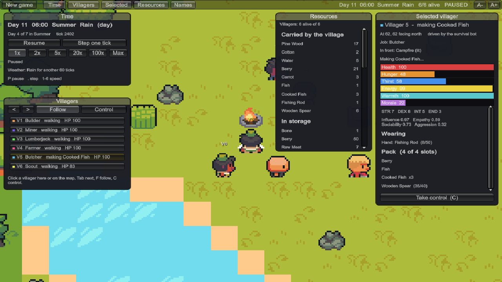
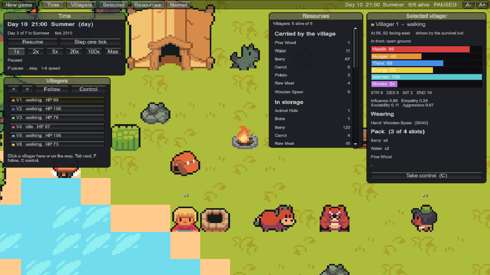
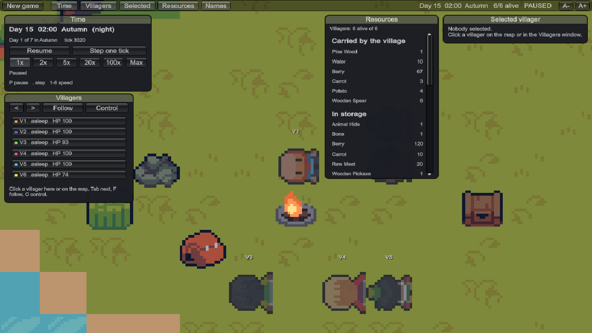
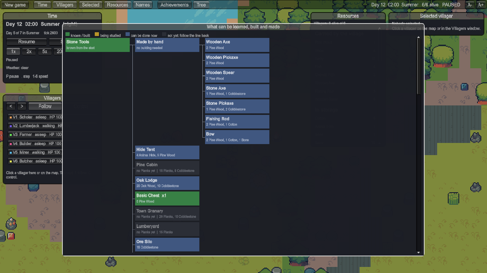

<h1 align="center">TinyTribe</h1>

<p align="center">
  Tiny agents learn to survive, then build a civilisation.<br />
  <samp>UNITY 6.3 LTS · C# · PYTORCH · ONNX · IMITATION AND REINFORCEMENT LEARNING</samp>
</p>

<p align="center">
  
</p>

### <samp>01 — WHAT IT IS</samp>

A 2D grid-based survival simulation where a small village has to stay alive through a year
of seasons, and where the villagers are meant to be driven by a neural network that learned
how. The game supplies the rules; the villagers are supposed to find the answers.

**Status: the game is playable and the training pipeline runs end to end.** Scripted bots
keep a village alive for a whole year. The trained networks do not yet: the best one lasts
about 19 of 28 days. The numbers and what was learned on the way are in
[section 04](#04--where-it-stands).

### <samp>02 — THE GAME</samp>

- **A world that changes.** A year is four seasons of seven days. Rain, storms and heat
  come and go, nights are dark, and winter has to be prepared for.
- **Needs that compete.** Health, hunger, thirst, energy, warmth and morale. Let one fail
  and the villager suffers or dies.
- **Things to make.** 57 items, 36 recipes and 27 buildings, from a campfire and a chest up
  to a smeltery and a library, unlocked through a tree of what the village has learned.
- **Jobs and a council.** Twelve jobs (lumberjack, miner, farmer, cook, butcher, builder,
  scout and more), handed out and changed by votes.
- **Animals and sickness.** Rabbits and deer to hunt, wolves and bears to stay away from,
  and eight sicknesses, from a cold caught in the rain to food poisoning from raw meat.
- **Family life.** Villagers form opinions of each other, marry, share a home and have
  children, so a village can grow past the six it starts with.
- **43 achievements** that say how far a village got, from "First Night" to "A Town".

You can watch at anything from 1x to 100x speed, follow any villager, or take one over and
play it yourself.

<table>
  <tr>
    <td></td>
    <td></td>
    <td></td>
  </tr>
</table>

### <samp>03 — HOW THE VILLAGERS LEARN</samp>

Every tick each villager sees an 11×11 patch of the map around it, a vector of 195 numbers
about itself and the village, and a mask of what is possible right now. It answers with one
of 21 actions and an argument.

| Step | What happens |
|---|---|
| 1. Demonstrations | Scripted survival bots play villages; every tick is recorded |
| 2. Imitation | The network learns to choose what the bots chose |
| 3. Imitation with correction | The network plays by itself, the bot says what it would have done, and the network trains on those situations too (DAgger) |
| 4. Learning from outcomes | The network plays many villages and is rewarded only by the game (PPO) |
| 5. Judging | Networks and bots play whole years on maps nothing was trained on |
| 6. Into the game | The network is exported to `.onnx` and runs inside Unity, offline |

The network is a CNN over the map patch, an MLP over the vector and an LSTM for memory,
with heads for action, argument and value: about 1.07 million parameters, written in plain
PyTorch. The simulation is deterministic, so a seed and the actions give the same village
tick for tick, and every experiment stores its command, settings, code version and the
hash of the balance workbook.

The scripted bot is a baseline and a teacher to start from, not the goal.

### <samp>04 — WHERE IT STANDS</samp>

Sixteen villages of six, one 28-day year each, on maps nothing was trained on:

| Who plays | Days the village lasted | Alive at the end | Achievements |
|---|---|---|---|
| Scripted bots | 27.5 | 5.6 | 22.5 |
| Best network so far (imitation with correction) | 19.2 | 0 | 8.4 |
| First imitation network<sup>*</sup> | 4.5 | 0 | 3.9 |
| Blind choice among what is possible<sup>*</sup> | 2.9 | 0 | 2.8 |

<sub><sup>*</sup> Measured before family life was added, when the bots scored 26.9 / 5.1 / 20.3 on the same maps.</sub>

No network has built a campfire yet, so none gets a villager through the winter. The best
ones have started to build: a chest in 10 of 16 villages, a garden in 4.

Some of what 47 experiments turned up:

- **The first run of learning from outcomes made things worse**, from 17 days down to 4.6.
  Policy and value shared one network, so an untrained critic overwrote what imitation had
  taught. The critic is now a network of its own.
- **No network could walk to a tree**, because the compass the villager sees and the target
  the bot walks to did not mean the same thing.
- **The memory was in the way.** Everything a villager saw had to pass through the LSTM
  first. The heads now read the present directly, beside what the LSTM remembers.

The whole story, in order, is in [`ML/JOURNAL.md`](./ML/JOURNAL.md). The same as one page
with every curve is `ML/REPORT.html` (download it and open it in a browser).

### <samp>05 — WHAT IS IN HERE</samp>

| Folder | What it is |
|---|---|
| [`Game/TinyTribe/Assets/Sim`](./Game/TinyTribe/Assets/Sim) | The rules. Plain C# with no Unity types, one tick at a time |
| [`Game/TinyTribe/Assets/Brains`](./Game/TinyTribe/Assets/Brains) | The scripted bots, and recording, replaying and exporting runs |
| [`Game/TinyTribe/Assets/Neural`](./Game/TinyTribe/Assets/Neural) | Runs a trained `.onnx` network inside the game |
| [`Game/TinyTribe/Assets/View`](./Game/TinyTribe/Assets/View) | What you see: map, villagers, animals, buildings and the windows |
| [`Game/TinyTribe/Assets/Tests`](./Game/TinyTribe/Assets/Tests) | 546 Edit-mode tests of the rules, plus Play-mode smoke tests |
| [`ML`](./ML) | The network, the trainers, evaluation and the report. Start at [`ML/README.md`](./ML/README.md) |
| [`ML/host`](./ML/host) | The same C# rules built as a console program that serves villages to Python |
| [`ML/experiments`](./ML/experiments) | Settings, numbers and curves of every experiment |
| [`Plan`](./Plan) | The design documents and the balance workbook |
| [`tools`](./tools) | `install_art.py`, which copies the art the game uses out of the downloaded packs |

### <samp>06 — RUNNING IT</samp>

You need Unity 6000.3 LTS, the .NET SDK, and Python 3.11 with PyTorch (CUDA), NumPy,
pandas, onnx, onnxruntime and openpyxl.

> **Only the scripts are tracked.** This repository holds the `.cs` and `.asmdef` files of
> the Unity project, not its scenes, `Packages/`, `ProjectSettings/` or art. A clone is
> enough to read the code and the training records. To open the game, put the `Assets`
> folder into a Unity 6000.3 Universal 2D project that has the Input System, Inference
> Engine, Newtonsoft Json and Test Framework packages. The game builds itself from code
> and needs no scene set up. This has not been tried from a clean clone yet.

```bash
python ML/export_data.py            # balance workbook -> JSON the game reads
python tools/install_art.py         # optional; without art the game draws simple pictures itself
dotnet build ML/host -c Release     # the standalone simulator used for training
```

Then press Play in Unity and choose who drives the villagers on the launch screen:
the survival bot, a trained network, random choice, or nobody.

| Key | What it does |
|---|---|
| <kbd>P</kbd> | Pause or resume |
| <kbd>.</kbd> | Step one tick |
| <kbd>1</kbd> to <kbd>6</kbd> | Speed |
| <kbd>Tab</kbd> | Next villager |
| <kbd>F</kbd> | Follow the selected villager |
| <kbd>C</kbd> | Take control of the selected villager (<kbd>Esc</kbd> to let go) |

Every training step, from recording the bots to putting a network into the game, is one
command each in [`ML/README.md`](./ML/README.md).

### <samp>07 — DOCUMENTS</samp>

| File | What it is |
|---|---|
| [`Plan/TinyTribe_GDD.md`](./Plan/TinyTribe_GDD.md) | Game design document: what the game is |
| [`Plan/TinyTribe_TechPlan.md`](./Plan/TinyTribe_TechPlan.md) | Tech plan: what it is built with, and why |
| `Plan/AISim_English_v12.xlsx` | The numbers: balance tables for the simulation, and the single source of truth |
| [`ML/README.md`](./ML/README.md) | The training pipeline, command by command |
| [`ML/JOURNAL.md`](./ML/JOURNAL.md) | Every experiment in the order it was run |

### <samp>08 — CREDITS AND LICENSE</samp>

The code is under the [MIT License](./LICENSE).

The art is not in this repository. The game uses three CC0 packs, downloaded separately:
[Ninja Adventure](https://pixel-boy.itch.io/ninja-adventure-asset-pack) by Pixel-Boy and AAA,
and the [Roguelike/RPG pack](https://kenney.nl/assets/roguelike-rpg-pack) and
[Emotes pack](https://kenney.nl/assets/emotes-pack) by Kenney.

<br />

<p align="center">
  <a href="https://github.com/Deatron01"></a><br />
  <sub><i>Little chaos in a quiet mind.</i></sub><br />
  <sub><samp>MORE WORK AT <a href="https://github.com/Deatron01">GITHUB.COM/DEATRON01</a></samp></sub>
</p>
